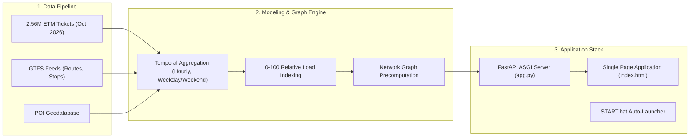

# 📑 Project Proposal: CrowdWise Delhi

> **Hackathon Track**: National Level Hackathon (GLA University, Mathura)  
> **Challenge**: Problem 2 — Crowdedness-Aware Journey Planner  
> **Project Name**: **CrowdWise Delhi** — Crowdedness-Aware Bus Journey Planner  

---

## 1. Problem We Chose

### Background & Context
Delhi operates one of the busiest bus transit networks in the world (DTC & DIMTS), serving over **4 million daily commuters** across 2,000+ routes. However, transit in Delhi suffers from severe temporal and spatial crowding:
* Morning peak hours (08:00 – 10:00 AM) generate over **374,000+ boardings/hour**.
* Evening peak hours (17:00 – 20:00 PM) create another surge exceeding **254,000+ boardings/hour**.
* Midday off-peak hours (12:00 – 15:00 PM) see a drop in demand of nearly **40–60%**, leaving buses under-utilized.

### The Pain Point
Every existing navigation tool (such as Google Maps, Apple Maps, or static timetables) calculates journeys based strictly on **shortest travel time or shortest distance**, operating under the assumption of infinite vehicle capacity. 

In the real world, this causes critical failures:
1. **The "Full Bus" Pass-By**: Buses reach 150%–200% capacity during peak hours and skip intermediate stops. A route that looks 10 minutes faster on a map often leaves commuters stranded at the bus stop for 30–45 minutes.
2. **Complete Commuter Blindness**: Commuters have no way of knowing whether an approaching bus is empty or crush-loaded. Often, an alternative route departing 10 minutes later or a parallel line has 40% lower passenger volume, but riders lack the data to make that choice.
3. **Disproportionate Impact**: Overcrowding causes severe physical fatigue, safety risks, and inaccessible conditions, particularly for female commuters, students, elderly citizens, and people with disabilities.

---

## 2. Our Approach

### Core Philosophy: "Crowd-First" Intelligent Transit
Instead of only answering *"Which bus is fastest?"*, CrowdWise answers:
> **"Which bus gets me there reliably with the highest comfort and least congestion?"**

### Key System Innovations:
* **Crowdedness-Weighted Route Scoring**: Routes are ranked using a multi-criteria optimization function balancing travel duration ($T$) and crowdedness level ($C$). Users can choose their priority:
  * **Fastest**: Minimizes travel time.
  * **Least Crowded**: Prioritizes buses with lowest passenger density and highest seat availability.
  * **Balanced**: The sweet spot between travel time and passenger comfort.
* **Simple Three-Tier Visual Indicators**:
  * 🟢 **Low Crowdedness**: High seat probability, low boarding stress.
  * 🟡 **Medium Crowdedness**: Standing room available, moderate density.
  * 🔴 **High Crowdedness**: Severe crush-load, high likelihood of pass-bys.
* **Smart Departure Shift Advice**: Recommends shifting departure by 15–30 minutes when a substantially calmer bus corridor is available.
* **Integrated Multimodal & POI Layer**: Combines bus transit with nearby Delhi Metro stations, cafes, and hospitals, calculating walking distance, walking duration (@ 4.8 km/h), calorie burn, and avoided $\text{CO}_2$ emissions.
* **One-Click Portable Deployment (`START.bat`)**: A zero-configuration launcher that auto-detects Python, auto-installs dependencies, detects dynamic ports, and opens Google Chrome without requiring manual command-line setups.

---

## 3. Data We Used

CrowdWise is grounded entirely in real-world empirical data without requiring costly hardware sensors, cameras, or surveillance:

### A. Electronic Ticketing Machine (ETM) Dataset
* **Source**: Delhi Open Transit Ticketing Dataset.
* **Volume**: **2,559,899 (2.56 million)** electronic ticket transactions across the full month of October 2026.
* **Signal Used**: Boarding timestamps, route identifiers, and stop sequence mappings used as an empirical proxy for corridor demand.

### B. Static Transit Network Feeds (GTFS)
* **Source**: Delhi Transport Stack GTFS open feed.
* **Files Used**:
  * `routes.txt`: Defines 2,259 total routes (1,628 actively modeled corridors).
  * `stops.txt`: Geographical coordinates (lat/lon) for 6,762 transit stops.
  * `trips.txt` & `stop_times.txt`: Timetables, stop sequences, and route geometries.

### C. Multimodal Points of Interest (POI) Database
* **Volume**: 141 geocoded transit and lifestyle nodes:
  * **80 Delhi Metro Stations**: Major interchange hubs for intermodal trip handoffs.
  * **36 Transit Cafes & Waiting Zones**: Low-stress waiting spots during peak congestion windows.
  * **25 Major Hospitals**: Rapid routing to healthcare facilities.

---

## 4. Technical Architecture

---

## 5. Feasibility, Impact & Sustainability

* **Zero Hardware Overhead**: Relies entirely on ticketing data already generated by bus conductors daily—no IoT cameras or weight sensors required.
* **Instant Speed**: Precomputed density tables ensure API responses return in **< 15 milliseconds**, easily scaling to millions of daily requests.
* **Network-Wide Load Balancing**: By guiding just 10–15% of flexible commuters away from peak buses to parallel routes or off-peak departures, citywide transit pressure drops significantly.
* **Public Health & Sustainability**: Encourages public transit adoption over private two-wheelers and cars, cutting urban traffic congestion and vehicular emissions in Delhi.
