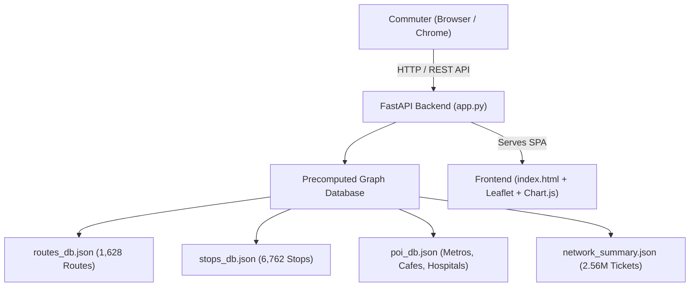

# 🚌 CrowdWise — Crowdedness-Aware Delhi Bus Journey Planner

[](https://www.python.org/)
[](https://fastapi.tiangolo.com/)
[](https://leafletjs.com/)
[](https://www.chartjs.org/)
[](https://opensource.org/licenses/MIT)

**CrowdWise** is an intelligent, crowdedness-aware urban transit journey planner designed specifically for the Delhi Bus Transit Network. Built on analysis of **2,559,899 ticketing records** from the Delhi Open Transit Dataset (October 2026), CrowdWise models passenger density across **1,628 routes** and **6,762 stops** to help commuters choose the most comfortable, least congested journeys.

---

## 🎯 Problem Statement & Proposal

> 📑 **Read the complete docs**: [Full Project Proposal (PROPOSAL.md)](PROPOSAL.md) • [Technical Note (TECHNICAL_NOTE.md)](TECHNICAL_NOTE.md)

### 1. Problem We Chose
Conventional public transit journey planners (e.g., Google Maps) optimize strictly for **shortest path or theoretical duration**, implicitly assuming infinite vehicle capacity and uniform passenger comfort.

In Delhi (DTC/DIMTS), where over **4 million passenger trips occur daily**, this causes severe real-world failures:
* **The "Full Bus" Pass-By**: Buses reach $150\%\text{--}200\%$ capacity during morning ($08:00\text{--}10:00$) and evening ($17:00\text{--}20:00$) surges, skipping intermediate stops and stranding commuters.
* **Information Asymmetry**: Commuters cannot see whether an approaching bus is crush-loaded, missing calmer alternative buses departing just 10–15 minutes apart.
* **Network-Wide Overload**: Passenger demand concentrates on a few popular corridors while parallel routes run under-capacity.

### 2. Our Approach
* **Crowd-First Optimization**: Evaluates journeys on both travel duration ($T$) and crowdedness level ($C$). Users can choose between **Fastest**, **Least Crowded**, or **Balanced**.
* **Three-Tier Crowd Badges**: Clear visual tags (🟢 Low, 🟡 Medium, 🔴 High) to immediately identify bus comfort.
* **Smart Departure Shift**: Advises commuters when shifting departure by 15–30 minutes offers a calmer, seated ride.
* **Multimodal Integration**: Connects bus routes with 80 Delhi Metro stations, cafes, and hospitals, showing walking minutes, calorie burn, and carbon offset.

### 3. Data We Used
* **2.56 Million ETM Records**: Electronic ticketing machine data from October 2026 across Delhi buses, used as an empirical boarding demand proxy without expensive IoT sensors.
* **GTFS Static Transit Feeds**: 1,628 active routes, 6,762 geocoded stops, stop schedules, and route geometries.
* **POI Geodatabase**: 141 mapped locations (80 Metro stations, 36 cafes, 25 major hospitals) with Haversine distance calculations.

---

## ✨ Features

- 🕒 **Crowdedness-Aware Route Planning**: Suggests the optimal bus route and tells you how packed the bus will be at your specific departure hour.
- 📊 **Hourly Congestion Profiles**: Visualizes hourly crowd levels (Morning Peak, Evening Surge, Midday Dip) with weekday vs. weekend comparisons powered by Chart.js.
- 🗺️ **Interactive Geographic Map**: Leaflet.js-powered Delhi transit map showing route trajectories, stop markers, and live transit lines.
- 🚇 **Multimodal POI Integration**: Displays nearest Delhi Metro interchange stations, cafes, and hospitals from any stop with walking minutes and distance estimates.
- 🚶 **Health & Eco-Tracker**: Calculates walking steps, calories burnt, and kg of CO₂ emissions saved compared to motorized travel.
- ⚡ **One-Click Startup (`START.bat`)**: Fully automated Windows launcher that verifies Python, auto-installs dependencies, dynamically detects the port, and automatically opens the website in Google Chrome.

---

## 🏛️ System Architecture



---

## 📊 Dataset & Analytics Highlights

| Metric | Value |
|---|---|
| **Total Ticketing Events Analyzed** | 2,559,899 |
| **Total Network Routes** | 2,259 (1,628 modeled with hourly profiles) |
| **Total Transit Stops** | 6,762 modeled stops |
| **Busiest Corridors** | 717A (Badarpur ↔ Nehru Place), 511A, 729, 623, 578 |
| **Morning Peak Congestion** | 08:00 – 10:00 AM (Peak at 09:00 with 374,218 tickets) |
| **Evening Peak Congestion** | 17:00 – 20:00 PM (Peak at 18:00 with 254,896 tickets) |
| **Quietest Travel Window** | 12:00 – 15:00 PM (Midday Dip) & after 20:30 PM |

---

## 🚀 Quick Start Guide

### Option 1: One-Click Launch (Recommended for Windows)

Simply double-click the included `START.bat` file in the project root:

1. Double-click **`START.bat`**.
2. The script will:
   - Auto-detect your Python environment (Python 3.10+).
   - Check and install required packages (`fastapi`, `uvicorn`).
   - Detect the configured port (`8765`).
   - Prevent duplicate server instances.
   - Start the backend and automatically open the application in **Google Chrome**.

---

### Option 2: Manual Terminal Startup

If you prefer running via command line or are on macOS/Linux:

1. **Clone the repository**:
   ```bash
   git clone https://github.com/Vyom1409/crowdwise.git
   cd crowdwise
   ```

2. **Install dependencies**:
   ```bash
   pip install fastapi uvicorn
   ```

3. **Start the backend server**:
   ```bash
   python app.py
   ```

4. **Open in your browser**:
   Navigate to [http://127.0.0.1:8765](http://127.0.0.1:8765) in your web browser.

---

## 🔌 API Endpoints Reference

| Method | Endpoint | Description |
|---|---|---|
| `GET` | `/` | Serves the single-page web application (`index.html`) |
| `GET` | `/api/search-stops?q={query}` | Search and autocomplete bus stops by name |
| `GET` | `/api/plan-journey?from_stop={orig}&to_stop={dest}&hour={h}&is_weekend={bool}` | Plans optimal journey with crowdedness predictions |
| `GET` | `/api/route-summary?route={route_id}` | Returns route stop list, distance, and 24-hour congestion curve |
| `GET` | `/api/all-pois` | Returns all mapped Delhi Metros, Cafes, and Hospitals |
| `GET` | `/api/nearby-poi?lat={lat}&lon={lon}&limit={n}` | Nearest POIs with calculated walking distance and time |
| `GET` | `/api/walking-calories?distance_km={km}&weight_kg={kg}` | Health calculation: calories burnt, steps, and CO₂ saved |
| `GET` | `/api/spot-checks` | Returns pre-verified transit verification routes |
| `GET` | `/api/network-summary` | High-level dataset summary metrics |

---

## 📁 Repository Structure

```text
crowdwise/
├── START.bat                  # One-click portable Windows launcher
├── app.py                     # FastAPI backend & API routing
├── index.html                 # Frontend SPA (Leaflet map, Chart.js, Tailwind styling)
├── analyze_data.py            # Dataset exploratory analytics script
├── create_poi_data.py         # POI compiler for Metro, Cafe, and Hospital coordinates
├── process_data.py            # GTFS & ticketing processor that generated graph DB
├── test_engine.py             # Route planning algorithm unit test
├── test_planner.py            # API endpoint integration test
├── .gitignore                 # Excludes raw heavy CSVs (>100MB) & Python caches
├── README.md                  # Project documentation & reference
├── backend_data/
│   ├── routes_db.json         # 1,628 routes with hourly crowdedness vectors
│   ├── stops_db.json          # 6,762 stops with lat/lon coordinates
│   ├── poi_db.json            # 141 Points of Interest (Metro, Cafes, Hospitals)
│   ├── network_summary.json   # High-level dataset statistics
│   └── spot_checks.json       # Precomputed test corridors
└── data/
    ├── routes.txt             # GTFS Routes definition
    ├── stops.txt              # GTFS Stops definition
    ├── stop_times.txt         # GTFS Stop schedules
    ├── trips.txt              # GTFS Trips catalog
    └── October-Delhi.csv.zip  # Compressed raw ticketing dataset (<100MB)
```

---

## 🛠️ Technology Stack

- **Backend**: [Python 3.10+](https://www.python.org/) • [FastAPI](https://fastapi.tiangolo.com/) • [Uvicorn](https://www.uvicorn.org/)
- **Frontend**: HTML5 • Modern CSS3 • JavaScript (ES6+)
- **Mapping & Charts**: [Leaflet.js](https://leafletjs.com/) • [Chart.js](https://www.chartjs.org/) • [OpenStreetMap](https://www.openstreetmap.org/)
- **Data Analytics**: NumPy • Pandas • Scikit-Learn • GTFS

---

## 📄 License

This project is licensed under the [MIT License](LICENSE).
