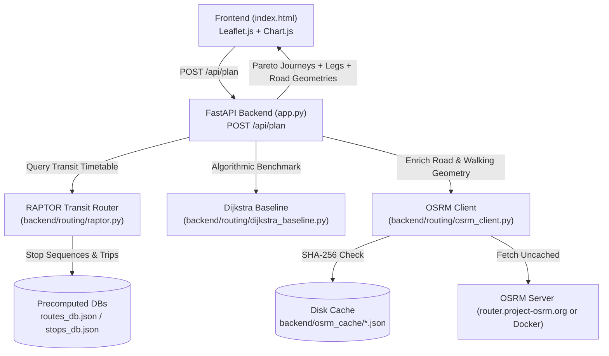

# 🚌 CrowdWise — Crowdedness-Aware Delhi Bus Journey Planner

[](https://www.python.org/)
[](https://fastapi.tiangolo.com/)
[](https://leafletjs.com/)
[](https://www.chartjs.org/)
[](https://opensource.org/licenses/MIT)

**CrowdWise** is an intelligent, crowdedness-aware urban transit journey planner designed specifically for the Delhi Bus Transit Network. Built on analysis of **2,559,899 ticketing records** from the Delhi Open Transit Dataset (October 2026), CrowdWise models passenger density across **1,628 routes** and **6,762 stops**, powered by the **RAPTOR** algorithm and **OSRM** road routing to deliver multi-objective, low-stress transit itineraries.

---

## 🎯 Problem Statement & Proposal

> 📑 **Read the complete docs**: [Full Project Proposal (PROPOSAL.md)](PROPOSAL.md) • [Technical Note (TECHNICAL_NOTE.md)](TECHNICAL_NOTE.md)

### 1. Problem We Chose
Conventional public transit journey planners (e.g., Google Maps) optimize strictly for **shortest path or theoretical duration**, implicitly assuming infinite vehicle capacity and uniform passenger comfort.

In Delhi (DTC/DIMTS), where over **4 million passenger trips occur daily**, this causes severe real-world failures:
* **The "Full Bus" Pass-By**: Buses reach $150\%\text{--}200\%$ capacity during morning ($08:00\text{--}10:00$) and evening ($17:00\text{--}20:00$) surges, skipping intermediate stops and stranding commuters.
* **Information Asymmetry**: Commuters cannot see whether an approaching bus is crush-loaded, missing calmer alternative buses departing just 10–15 minutes apart.
* **Network-Wide Overload**: Passenger demand concentrates on a few popular corridors while parallel routes run under-capacity.

### 2. Our Approach
* **RAPTOR Transit Routing**: Round-bAsed Public Transit Optimized Router calculates earliest arrival and transfer combinations across all 1,628 Delhi routes in $<30\text{ms}$.
* **OSRM Road & Walking Legs**: Replaces straight lines with real road curves and walking paths, displaying road distance and duration.
* **Multi-Criteria Optimization**: Recommends Pareto-optimal journeys with mode choices: **⚡ Fastest**, **⚖️ Balanced**, or **🪑 Least Crowded**.
* **Step-by-Step Itineraries**: Expandable timeline showing exact board/alight stops, walking segments, transfer junctions, and crowd badges.
* **Multimodal Integration**: Connects bus routes with 80 Delhi Metro stations, cafes, and hospitals, showing walking minutes, calorie burn, and carbon offset.

---

## ✨ Features

- 🧭 **RAPTOR Algorithm (`backend/routing/raptor.py`)**: Vector timetable scanning with transfer relaxation (footpaths $\le 300\text{m}$) and $K$-round Pareto frontier construction.
- 🛣️ **OSRM Road Navigation (`backend/routing/osrm_client.py`)**: Road-following geometries for bus legs (colored by crowdedness) and dashed lines for walking legs, backed by atomic SHA-256 disk caching in `backend/osrm_cache/`.
- 📊 **Empirical Crowdedness Models**: Grounded on 2.56M ETM tickets ($R^2 = 0.8981$, $\text{MAE} = 4.50$ passengers/hr, $+65.8\%$ accuracy gain vs static timetables).
- 🔬 **Algorithmic Benchmarks**: Live comparison of RAPTOR vs Time-Expanded Dijkstra baseline directly in the telemetry modal.
- 🐳 **Self-Hosted OSRM Support**: Includes `docker-compose.yml` for offline local routing with an India/Delhi OSM extract.
- ⚡ **One-Click Startup (`START.bat`)**: Fully automated Windows launcher that verifies Python, auto-installs dependencies, dynamically detects the port, and automatically opens the website in Google Chrome.

---

## 🏗️ System Architecture



---

## 🚀 Quickstart & Setup

Get CrowdWise running in **3 simple steps** with **zero manual configuration**:

1. **Download or Clone the Repository**:
   Download the repository ZIP from GitHub and extract it, or run:
   ```bash
   git clone https://github.com/Vyom1409/crowdwise.git
   cd crowdwise
   ```

2. **One-Click Launch for Your Operating System**:
   - 🪟 **Windows**: Double-click **`START.bat`**
   - 🍎 **macOS**: Double-click **`start.command`**
   - 🐧 **Linux**: Run **`./start.sh`** (or `bash start.sh`)

3. **Enjoy!**:
   The launcher automatically verifies Python 3.10+, creates a local isolated environment (`.venv`), installs dependencies, finds an open port, checks backend health, and opens the website directly in your browser.

> 🌐 **Direct URL once running:** <a href="http://127.0.0.1:8765" target="_blank" rel="noopener noreferrer">http://127.0.0.1:8765</a>

---

### 🛠️ Troubleshooting & Common Questions

| Issue | Solution |
| :--- | :--- |
| **"Python was not found"** | Install Python 3.10+ from [python.org](https://www.python.org/downloads/). On Windows, ensure **"Add Python to PATH"** is checked. |
| **Port 8765 is in use** | The launcher automatically searches and binds to the next free port (e.g. `8766`). Or pass `PORT=8800` as an environment variable. |
| **macOS gatekeeper blocks `start.command`** | Right-click `start.command` and select **Open**, or run `chmod +x start.command` in Terminal. |
| **Offline / no internet** | CrowdWise comes with vendored Leaflet and Chart.js libraries and cached bus routes. If OSRM road routing is unreachable, it automatically displays straight-line approximate routes with a visible notice. |
| **Stop the application** | Simply close the terminal/command prompt window that opened during startup. |

---

### 💻 Optional: Manual Terminal Run
```bash
python -m venv .venv
# Windows: .venv\Scripts\activate | macOS/Linux: source .venv/bin/activate
pip install -r requirements.txt
python app.py
```
Open **`http://127.0.0.1:8765`** in your browser.

---

## 🐳 Self-Hosting OSRM with Docker Compose

By default, CrowdWise connects to the public OSRM demo server (`http://router.project-osrm.org`) with local disk caching. To run completely offline or without public rate limits:

```bash
# 1. Create OSRM data directory
mkdir osrm_data

# 2. Download Delhi / Northern India extract from Geofabrik
curl -o osrm_data/delhi-latest.osm.pbf https://download.geofabrik.de/asia/india/northern-zone-latest.osm.pbf

# 3. Extract, partition, and customize the road network
docker run -t -v "${PWD}/osrm_data:/data" ghcr.io/project-osrm/osrm-backend osrm-extract -p /opt/car.lua /data/delhi-latest.osm.pbf
docker run -t -v "${PWD}/osrm_data:/data" ghcr.io/project-osrm/osrm-backend osrm-partition /data/delhi-latest.osrm
docker run -t -v "${PWD}/osrm_data:/data" ghcr.io/project-osrm/osrm-backend osrm-customize /data/delhi-latest.osrm

# 4. Start the local OSRM routing service
docker compose up -d

# 5. Point CrowdWise to the local OSRM service
export OSRM_BASE_URL=http://localhost:5000   # Linux/macOS
set OSRM_BASE_URL=http://localhost:5000      # Windows CMD
$env:OSRM_BASE_URL="http://localhost:5000"  # Windows PowerShell
python app.py
```

---

## 📡 API Reference

### Plan Journey (RAPTOR + OSRM + Crowd-Aware)
* **Endpoint**: `POST /api/plan` (also supports `GET /api/plan`)
* **Request Body**:
```json
{
  "origin": "Badarpur Border",
  "destination": "Khanpur Extension / Devli Xing",
  "depart_time": "09:00",
  "mode": "balanced",
  "max_transfers": 2,
  "weekend": false
}
```
* **Modes**:
  * `fastest`: Minimizes total travel duration.
  * `least_crowded`: Maximizes seat availability and passenger comfort.
  * `balanced`: Optimal multi-objective trade-off between time, transfers, and crowdedness.
* **Response**: Returns a Pareto set of journeys with step-by-step legs (`bus` with road geometry and crowdedness %, `walk` with distance and duration), total duration, transfers count, calorie burn, and nearest POIs.

### Benchmarks & Algorithmic Telemetry
* **Endpoint**: `GET /api/benchmark/metrics`
* **Response**: Returns live RAPTOR query time, rounds executed, Pareto frontier count, Dijkstra baseline comparison (query time, nodes settled, edges relaxed), OSRM cache hit rate %, and empirical model validation stats ($R^2$, MAE).

---

## 🧪 Testing

```bash
# Run RAPTOR toy network unit tests (transfer & crowd-aware trade-offs)
python test_raptor.py

# Run transit engine and stop matching integration tests
python test_engine.py

# Run planner sanity test
python test_planner.py
```

---

## 📄 License

This project is licensed under the MIT License — see the [LICENSE](LICENSE) file for details.
